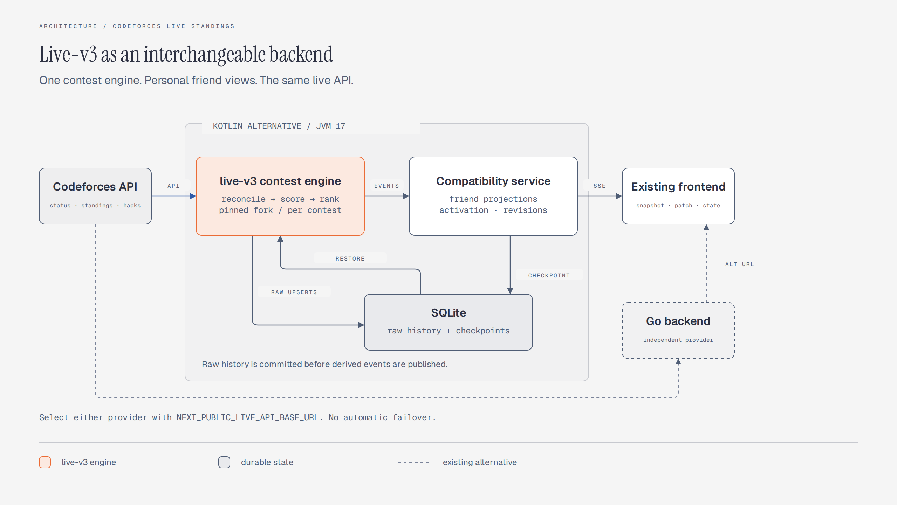

# live-v3 backend alternative

An independent JVM 17 service using the pinned `mc-cari/live-v3` fork for ingestion,
raw-history reconciliation, verdict processing, hacks, scoring and ranking. This
service adds SQLite durability, contest activation, friend projections and the
existing HTTP/SSE interface. It does not import or call the Go backend.



## Build and run

From the repository root:

```sh
git submodule update --init vendor/live-v3
cd backend-live-v3
./gradlew test installDist
DATA_DIR=../.live-v3-data LISTEN_ADDR=127.0.0.1:8091 \
  ALLOWED_ORIGINS=http://localhost:3000 \
  build/install/live-v3-backend/bin/live-v3-backend
```

The submodule is the immutable dependency pin; neither builds nor production
follow a floating branch. `LIVE_V3_SOURCE=/absolute/fork/checkout` is an explicit
local-development override only. Both services can run independently. Select this
one when building/running the frontend with
`NEXT_PUBLIC_LIVE_API_BASE_URL=http://127.0.0.1:8091`. Set `ALLOWED_ORIGINS` to the
actual frontend origin. Switching a deployed frontend requires its normal rebuild.

Container alternative, from the repository root:

```sh
docker compose -f docker-compose.live-v3.yml up --build -d
```

This uses port 8091, its own named `live-v3-data` volume containing
`/data/live-v3.sqlite`, and host-loopback metrics on 9091. It does not change the Go compose stack or a production tunnel. Point the
chosen public API hostname/tunnel at this provider only after validation; do not
proxy the metrics listener publicly. Roll back by selecting the Go provider URL.

## Configuration and behavior

| Setting | Default |
| --- | --- |
| `DATA_DIR` | `/data`; database `live-v3.sqlite` |
| `LISTEN_ADDR` | `:8080` |
| `METRICS_LISTEN_ADDR` | `127.0.0.1:9090` (separate listener) |
| `CF_API_BASE_URL` | `https://codeforces.com/api/` |
| `POLL_INTERVAL_MS` | 4200, delay after each complete reload |
| `CF_REQUEST_INTERVAL_MS` | 2100, shared across all contests/methods |
| `ALLOWED_ORIGINS` / `ALLOWED_ORIGIN` | comma-separated exact/wildcard origins |
| `MAX_SSE_CONNECTIONS` | 128 concurrent streams; excess connections receive 429 |
| `TELEMETRY_TOKEN` | empty: ingestion disabled/unauthorized |
| `CF_MANAGER_MODE` | false: anonymous public requests |
| `CF_API_KEY`, `CF_API_SECRET` | required only for manager mode |
| `JAVA_OPTS` | JVM options; compose defaults to `-Xmx1536m` |

Three active contests and seven-day retention match the existing defaults. Full
CF reloads include the hacks endpoint, so pacing and response time can lengthen
the effective refresh interval. Dedicated clients are explicitly closed after
requests for transport compatibility; this does not claim a latency improvement.

Supported: CF and ICPC scoring, individual official and out-of-competition entries.
Teams, practice/virtual sessions, IOI/BLITZ and a new replay UI are excluded from v1.
The service returns conflict for unsupported scoring formats. Friend selection is
case-insensitive and uses live-v3 ranking over precomputed selected rows, including
unofficial friends in local ranks. Synthetic hack runs affect scores/counters but
are excluded from real submission links and problem columns.

Raw submissions/hacks are upserted before conversion and retained on omission or
empty responses. Original verdict/test/resource fields are preserved as metadata.
Partial upstream failures keep the last published state and mark it stale. Final
state requires two complete FINISHED reloads with no pending submissions or hacks.
System-testing phases do not terminate tracking.

Persisted checkpoints retain all friend-capable submissions; the 10,000-entry cap
is applied only after selecting a viewer’s friends, including during restoration.
Failed initial activations retain history for the retention period, then inactive
records without snapshots and their raw history are pruned.

Snapshots and publication use the same lock as subscriber registration. Reconnects
start with a fresh snapshot. Slow viewers receive a full snapshot after skipped
revisions or when submissions leave the display window, preventing lost upserts
and stale entries. Stream admission is bounded and slots are released on failed
handshakes and disconnects. SQLite commits precede publication; raw history
is restored before scoring. Restored snapshots are stale until a fresh reload.
Finished state is retained and can be served after restart.

HTTP compatibility: `POST /v1/contests/{id}/activate`,
`GET /v1/contests/{id}/events?h=<base64url semicolon-separated handles>`,
`GET /healthz`, `GET /readyz`, and authenticated `POST /v1/telemetry`.
SSE events remain `snapshot`, `patch`, `state`, with 15-second heartbeats. Health
`readyz` means the process/store initialized, not that Codeforces is reachable.
Metrics stay on a separate listener and retain the `cf_backend_*`, `cf_usage_*`
and `cf_codeforces_*` naming families. Telemetry receipts deduplicate event IDs.

## Validation

```sh
# Service integration, durability, official fixture and 10,000-submission tests
cd backend-live-v3 && ./gradlew test installDist
# Engine tests and exported public API checks
cd ../vendor/live-v3
./gradlew :cds:plugins:codeforces:test :cds:core:test \
  :cds:plugins:codeforces:apiCheck :cds:core:apiCheck
# The same HTTP/SSE assertions against both real processes
cd ../../backend && go test ./... && go build -o /tmp/live-go .
cd ../backend-live-v3 && python3 tests/contract.py --go /tmp/live-go
```

The recorded contest-1797 fixture includes capture time, source URLs and selection
criteria. Its official scores/problem results are checked independently of Go.
Engine tests also cover the existing 440 / 4,978 / 8,693 unofficial regressions,
score floors, nonstandard durations, rejudging, and hacks. The scale test prints
initial reload plus durable publication time (about 12 seconds locally for 10,000
submissions); this is not a production performance guarantee.

For the real browser test, install frontend dependencies with `pnpm install
--frozen-lockfile` in `frontend/`, use a Python environment with
`tests/requirements-browser.txt`, and install its Chromium browser. Then:

```sh
python3 tests/run-browser.py
```

The runner owns local fixture servers, a temporary TLS certificate and database,
the real service and Next.js on ports 19080/19081/19082/19090/3002. It verifies
initial snapshots, actual patches, exact testing badges, late reloads, separate
friend views, and reconnects without duplicates. It never mocks the SSE endpoint.
Screenshots land in `/tmp/live-v3-browser` or `BROWSER_ARTIFACT_DIR`.

No automatic database migration from Go, shared database, or provider failover is
implemented. A cold provider cannot recover submissions never observed if the
upstream currently omits them. Start tracking before the contest or validate with
recorded inputs before switching a live contest.
